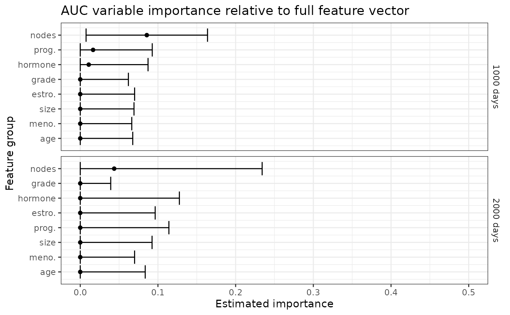
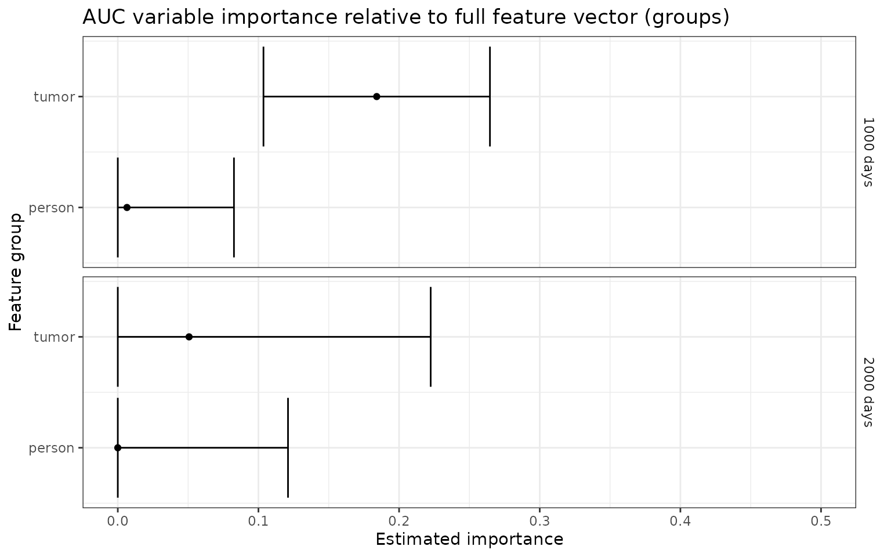
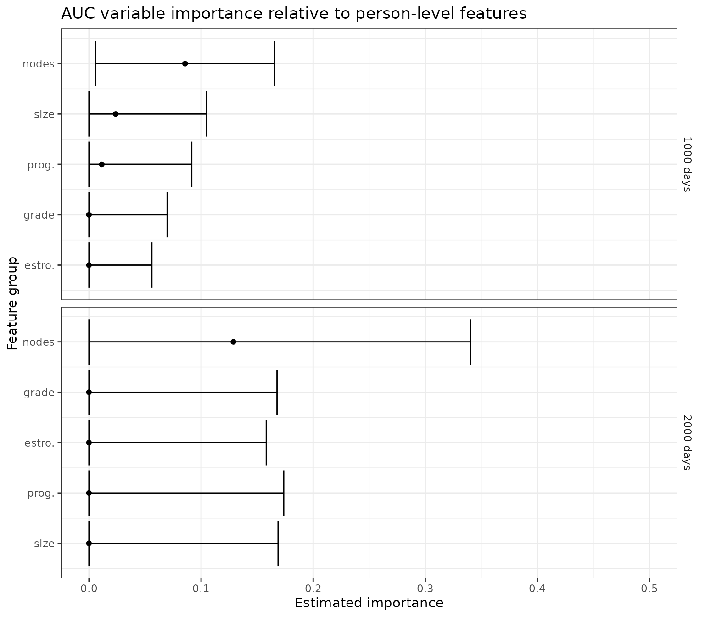
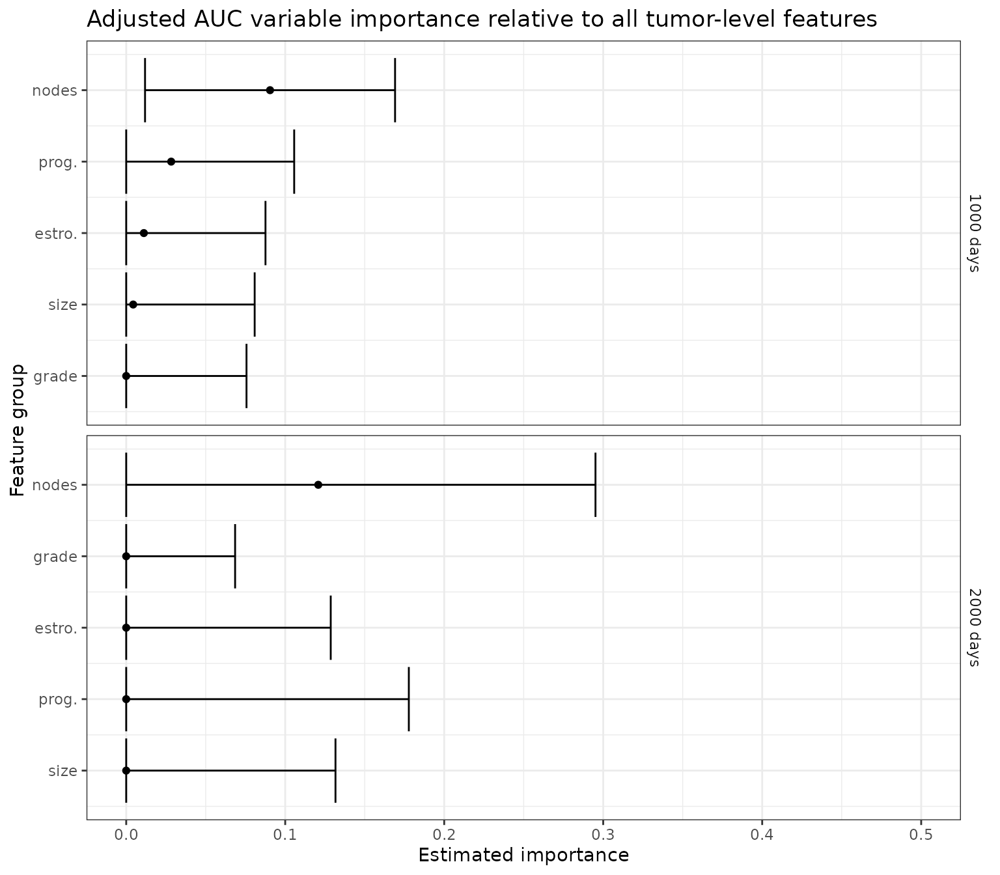

# Variable importance in survival analysis: overview

``` r
library(survML)
#> Loading required package: SuperLearner
#> Loading required package: nnls
#> Loading required package: gam
#> Loading required package: splines
#> Loading required package: foreach
#> Loaded gam 1.22-6
#> Super Learner
#> Version: 2.0-29
#> Package created on 2024-02-06
library(survival)
library(dplyr)
#> 
#> Attaching package: 'dplyr'
#> The following objects are masked from 'package:stats':
#> 
#>     filter, lag
#> The following objects are masked from 'package:base':
#> 
#>     intersect, setdiff, setequal, union
library(ggplot2)
set.seed(72924)
```

## Introduction

The `survML` package includes functions that can be used to estimate
model-free, algorithm-agnostic variable importance when the outcome of
interest is subject to right censoring. Specifically, this functionality
is aimed at estimating *intrinsic* variable importance, which is the
population-level predictiveness potential of a feature or group of
features.

Suppose we have access to a vector $X$ of features, which we wish to use
to make a prediction involving $T$, a time-to-event outcome. We use $C$
to denote the right censoring variable. The observed data are given by
$(X,Y,\Delta)$, where $\Delta:=I(T \leq C)$ and $Y:=\text{min}(T,C)$.
For an index set $s$, we use $X_{s}$ to denote the elements of $X$ with
index in $s$ and $X_{- s}$ its complement. For a given prediction task
(say, estimating the probability that $T$ is smaller than some landmark
time $\tau$) and prediction function $f$, we require a measure of
predictiveness. We let $V\left( f,P_{0} \right)$ denote the
predictiveness of $f$ under sampling from distribution $P_{0}$. We
define $f_{0,s}$ as the *oracle prediction function* excluding features
with index in $s$; this is the best possible prediction function,
according to $V$, that uses only $X_{- s}$.

For intrinsic variable importance, we consider nested index sets
$r \subset s$ and define the importance of $X_{s\backslash r}$ relative
to $X_{s}$ as
$V\left( f_{0,r},P_{0} \right) - V\left( f_{0,s},P_{0} \right)$; this is
the difference in maximum achievable predictiveness when only $r$ is
excluded compared to when $s$ is excluded. We refer to this parameter as
a variable importance measure (VIM). Colloquially, we refer to $X_{- r}$
and $X_{- s}$ as the ‘large’ and ‘small’ feature groups, respectively.
Variable importance is assessed by comparing the predictiveness of a
model using the large feature group to that of a model using the small
feature group.

Due to right censoring, the VIM estimation procedure requires estimates
of the conditional survival functions of $T$ and $C$ given $X$, which we
define pointwise as $S_{0}(t \mid x):=P_{0}(T > t \mid X = x)$ and
$G_{0}(t \mid x):=P_{0}(C > t \mid X = x)$, respectively. These
functions must be estimated over the interval $(0,\tau\rbrack$ and may
be obtained from any conditional survival estimation algorithm. This may
be as simple as a Cox proportional hazards model (Cox, 1972) or
parametric survival regression model, or as complex as a stacked
regression procedure such as survival Super Learner (Westling et al.,
2023) or global survival stacking (Wolock et al., 2024).

We also require estimates of the oracle prediction functions $f_{0,r}$
and $f_{0,s}$, which we refer to as the ‘large’ and ‘small’ oracle
prediction functions, respectively, and whose exact form depends on the
chosen predictiveness measure. For several commonly used measures, the
oracle prediction functions can be written in terms of
$S_{0}( \cdot \mid x)$. The form of the oracle prediction function for
the measures included in `survML` is given in the Appendix.

## Example: Predicting recurrence-free survival time in cancer patients

As an example, we consider estimating variable importance for predicting
recurrence-free survival using the `gbsg` dataset in the `survival`
package. The Kaplan-Meier estimate of the survival curve for this
dataset is shown below.

``` r
data(cancer)
km_fit <- survfit(Surv(rfstime, status) ~ 1, data = gbsg)
plot(km_fit, xlab = "Time (days)", ylab = "Recurrence-free survival probability")
```


We will consider time-varying AUC importance using landmark times of
1000 and 2000 days. The first step is to prepare the data. We use dummy
coding for factors. This means that to assess the importance of tumor
grade, for example, which has three levels, we create two dummy
variables called `tumgrad2` and `tumgrad3` and consider them as a single
feature group. We also consider the feature groups defined by
tumor-level features and patient-level features.

``` r
### variables of interest
# rfstime - recurrence-free survival
# status - censoring indicator
# hormon - hormonal therapy treatment indicator
# age - in years
# meno - 1 = premenopause, 2 = post
# size - tumor size in mm
# grade - factor 1,2,3
# nodes - number of positive nodes
# pgr - progesterone receptor in fmol
# er - estrogen receptor in fmol

# create dummy variables and clean data
gbsg$tumgrad2 <- ifelse(gbsg$grade == 2, 1, 0)
gbsg$tumgrad3 <- ifelse(gbsg$grade == 3, 1, 0)
gbsg <- gbsg %>% na.omit() %>% select(-c(pid, grade))

time <- gbsg$rfstime
event <- gbsg$status
X <- gbsg %>% select(-c(rfstime, status)) # remove outcome 

# find column indices of features/feature groups
X_names <- names(X)
age_index <- paste0(which(X_names == "age"))
meno_index <- paste0(which(X_names == "meno"))
size_index <- paste0(which(X_names == "size"))
nodes_index <- paste0(which(X_names == "nodes"))
pgr_index <- paste0(which(X_names == "pgr"))
er_index <- paste0(which(X_names == "er"))
hormon_index <- paste0(which(X_names == "hormon"))
grade_index <- paste0(which(X_names %in% c("tumgrad2", "tumgrad3")), collapse = ",")
tum_index <- paste0(which(X_names %in% c("size", "nodes", "pgr", "er", "tumgrad2", "tumgrad3")),
                    collapse = ",")
person_index <- paste0(which(X_names %in% c("age", "meno", "hormon")), collapse = ",")

feature_group_names <- c("age", "meno.", "size", "nodes",
                         "prog.", "estro.", "hormone", 
                         "grade")
feature_groups <- c(age_index, meno_index, size_index, nodes_index,
                    pgr_index, er_index, hormon_index, grade_index)
```

### Estimating variable importance relative to all features

First, we consider the importance of each of the feature groups relative
to the full feature vector. Here, the features of interest are
subtracted from the full feature vector, with importance measured by the
resulting loss in predictiveness.

We begin by estimating the importance of age relative to the full
feature vector using the
[`vim()`](https://cwolock.github.io/survML/reference/vim.md) function.
In this case, we will compare the AUC achieved when all features are
included to the AUC when all features except for age are included;
therefore, the `large_feature_vector` consists of all features, and the
`small_feature_vector` consists of all features except for age.

There are three options for estimating the nuisance functions
(conditional survival functions and two oracle prediction functions).
Briefly, they include

1.  Use `survML`’s built-in algorithms, which are based on using
    [`stackG()`](https://cwolock.github.io/survML/reference/stackG.md)
    to estimate the conditional survival functions and
    [`SuperLearner()`](https://rdrr.io/pkg/SuperLearner/man/SuperLearner.html)
    to estimate the oracle prediction functions.
2.  Provide a function to estimate each nuisance.
3.  Provide pre-computed estimates for each nuisance.

These are ordered from least to most flexible; in this vignette, we
focus on (1), although we will also use (3) below, when we repeat calls
to [`vim()`](https://cwolock.github.io/survML/reference/vim.md) while
using the already-computed nuisance estimates. When using the built-in
nuisance estimation algorithms, control parameters can be set using the
`conditional_surv_generator_control`, `large_oracle_generator_control`,
and `small_oracle_generator_control` arguments. To reduce runtime in
this example, we use a very small Super Learner library and large
`bin_size` to estimate the conditional survival nuisance functions (see
[`stackG()`](https://cwolock.github.io/survML/reference/stackG.md)
function documentation), as well as the two oracle prediction functions
(see the `SuperLearner` package documentation).

We also use two-fold cross-fitting (i.e, set `cf_fold_num = 2`) and
two-fold cross-validation for nuisance estimation (i.e., set `V = 2` for
each nuisance estimator). Finally, we use a relatively coarse grid of 40
timepoints, evenly spaced on the quantile scale of observed event times,
for the `approx_times` argument, which determines the grid over which
integrals are approximated in the estimation procedure. In actual
analyses, it is generally a good idea to use a larger library of
learners, more cross-fitting and cross-validation folds, a finer grid of
`approx_times`, and a smaller `bin_size`.

Note that we also set `sample_split = TRUE`. In order to obtain valid
inference under the null hypothesis of zero importance, sample splitting
is required. If this option is set to `FALSE`, no p-value will be
returned, and caution should be used when interpreting the resulting
confidence interval.

``` r
# landmark times for AUC
landmark_times <- c(1000, 2000)

output <- vim(type = "AUC",
              time = time,
              event = event,
              X = X,
              landmark_times = landmark_times,
              large_feature_vector = 1:ncol(X),
              small_feature_vector = (1:ncol(X))[-as.numeric(age_index)],
              conditional_surv_generator_control = list(SL.library = c("SL.mean", "SL.glm"),
                                                        V = 2,
                                                        bin_size = 0.5),
              large_oracle_generator_control = list(SL.library = c("SL.mean", "SL.glm"),
                                                    V = 2),
              small_oracle_generator_control = list(SL.library = c("SL.mean", "SL.glm"),
                                                    V = 2),
              approx_times = sort(unique(stats::quantile(time[event == 1 & time <= max(landmark_times)],
                                                         probs = seq(0, 1, by = 0.025)))),
              cf_fold_num = 2,
              sample_split = TRUE,
              scale_est = TRUE)
#> Warning: glm.fit: fitted probabilities numerically 0 or 1 occurred
#> Warning: glm.fit: fitted probabilities numerically 0 or 1 occurred
#> Warning: glm.fit: fitted probabilities numerically 0 or 1 occurred
#> Warning: glm.fit: fitted probabilities numerically 0 or 1 occurred
#> Warning: glm.fit: fitted probabilities numerically 0 or 1 occurred
output$result$indx <- rep(age_index, nrow(output$result))
output$result$indx_name <- rep("age", nrow(output$result))
output$result
#>   landmark_time est   var_est cil        ciu cil_1sided         p
#> 1          1000   0 0.5064895   0 0.06755926          0 0.5799834
#> 2          2000   0 3.3089520   0 0.08363344          0 0.8661705
#>   large_predictiveness small_predictiveness vim large_feature_vector
#> 1            0.7049526            0.7127091 AUC    1,2,3,4,5,6,7,8,9
#> 2            0.6523270            0.7612004 AUC    1,2,3,4,5,6,7,8,9
#>   small_feature_vector indx indx_name
#> 1      2,3,4,5,6,7,8,9    1       age
#> 2      2,3,4,5,6,7,8,9    1       age
```

If we want to examine other features, we could simply repeat the above
call to [`vim()`](https://cwolock.github.io/survML/reference/vim.md),
substituting in the correct `large_feature_vector` and
`small_feature_vector`. However, this would be computationally
inefficient, as many of the nuisance functions needed to estimate the
other VIMs are identical to what was required to estimate the importance
of age. In this case, the conditional survival functions of $T$ and $C$,
as well as the large oracle prediction function, are the same for each
feature group of interest; all that changes as we iterate over different
feature groups is the small oracle prediction function. Note that in
addition to the results data frame (`output$results`), the
[`vim()`](https://cwolock.github.io/survML/reference/vim.md) function
also returned several other objects:

- `folds` contains the cross-fitting and sample-splitting folds that
  were generated by the call to
  [`vim()`](https://cwolock.github.io/survML/reference/vim.md)
- `approx_times` is the grid of times that was used to estimate the
  quantities needed for variable importance
- `conditional_surv_preds` contains the estimated conditional survival
  functions of $T$ and $C$
- `large_oracle_preds` contains the estimated large oracle prediction
  function (using all features)
- `small_oracle_preds` contains the estimated small oracle prediction
  function (using all features except, in this case, for age)

As we examine the importance of other features relative to the full
feature vector, we can recycle `conditional_surv_preds` and
`large_oracle_preds` (which requires us to use the same `folds` and
`approx_times` as well). This is an example of using pre-computed
nuisance estimates in the
[`vim()`](https://cwolock.github.io/survML/reference/vim.md) function.
We can then look at the results for all feature groups.

``` r
# save the objects that we will reuse
saved_conditional_surv_preds <- output$conditional_surv_preds
saved_large_oracle_preds <- output$large_oracle_preds
saved_folds <- output$folds
saved_approx_times <- output$approx_times

pooled_output <- output$result # save the results for age

# iterate over other feature groups
for (i in 2:length(feature_group_names)){
  indx_char <- feature_groups[i]
  indx_name <- feature_group_names[i]
  indx <- as.numeric(strsplit(indx_char, split = ",")[[1]])
  
  output <- vim(type = "AUC",
                time = time,
                event = event,
                X = X,
                landmark_times = landmark_times,
                approx_times = saved_approx_times,
                large_feature_vector = 1:ncol(X),
                small_feature_vector = (1:ncol(X))[-indx],
                conditional_surv_preds = saved_conditional_surv_preds,
                large_oracle_preds = saved_large_oracle_preds,
                cf_folds = saved_folds$cf_folds,
                ss_folds = saved_folds$ss_folds,
                small_oracle_generator_control = list(SL.library = c("SL.mean", "SL.glm"),
                                                      V = 2),
                sample_split = TRUE,
                scale_est = TRUE)
  
  output$result$indx <- rep(indx_char, nrow(output$result))
  output$result$indx_name <- rep(indx_name, nrow(output$result))
  pooled_output <- rbind(pooled_output, output$result)
}

plot_results <- function(results, plot_title){
  # plot results
  p_auc <- results %>%
    mutate(landmark_time = factor(landmark_time,
                                  levels = c(1000, 2000),
                                  labels = c("1000 days", "2000 days"))) %>%
    arrange(landmark_time, est) %>%
    mutate(Order = row_number()) %>%
    {ggplot(., aes(x = est, y = Order)) +
        geom_errorbarh(aes(xmin = cil, xmax = ciu)) +
        geom_point() +
        theme_bw() +
        xlab("Estimated importance") +
        ylab("Feature group") +
        xlim(c(0,0.5)) +
        scale_y_continuous(
          breaks = .$Order,
          labels = .$indx_name,
        ) + 
        facet_wrap(~landmark_time, dir = "v", strip.position = "right", scales = "free_y", ncol = 1) + 
        ggtitle(plot_title)+
        theme(strip.background = element_blank(),
              strip.placement = "outside")
    }
  return(p_auc)
}

p_auc <- plot_results(pooled_output, "AUC variable importance relative to full feature vector")
#> Warning: `geom_errorbarh()` was deprecated in ggplot2 4.0.0.
#> ℹ Please use the `orientation` argument of `geom_errorbar()` instead.
#> This warning is displayed once every 8 hours.
#> Call `lifecycle::last_lifecycle_warnings()` to see where this warning was
#> generated.
p_auc
```



We can also look at the importance of all tumor-level features and all
person-level features relative to the full feature vector.

``` r
# consider joint importance of all tumor-level and person-level features
feature_group_names2 <- c("tumor", "person")
feature_groups2 <- c(tum_index, person_index)
# repeat the analysis for feature groups
for (i in 1:length(feature_group_names2)){
  indx_char <- feature_groups2[i]
  indx_name <- feature_group_names2[i]
  indx <- as.numeric(strsplit(indx_char, split = ",")[[1]])
  
  output <- vim(type = "AUC",
                time = time,
                event = event,
                X = X,
                landmark_times = landmark_times,
                approx_times = saved_approx_times,
                large_feature_vector = 1:ncol(X),
                small_feature_vector = (1:ncol(X))[-indx],
                conditional_surv_preds = saved_conditional_surv_preds,
                large_oracle_preds = saved_large_oracle_preds,
                small_oracle_generator_control = list(SL.library = c("SL.mean", "SL.glm"),
                                                      V = 2),
                cf_folds = saved_folds$cf_folds,
                ss_folds = saved_folds$ss_folds,
                sample_split = TRUE,
                scale_est = TRUE)
  
  output$result$indx <- rep(indx_char, nrow(output$result))
  output$result$indx_name <- rep(indx_name, nrow(output$result))
  if (!(i == 1)){
    pooled_output <- rbind(pooled_output, output$result)
  } else{
    pooled_output <- output$result
  }
}

p_auc <- plot_results(pooled_output, "AUC variable importance relative to full feature vector (groups)")
p_auc
```



### Estimating variable importance relative to base model

Next, we consider the importance of each of the tumor-level features
relative to a *baseline* set of person-level features. Here, the feature
of interest is added to a baseline set of features, with importance
measured by the resulting gain in predictiveness. (Referring to this as
VIM “relative to the base model” is an abuse of terminology — it would
be more accurate to describe this as VIM of the feature of interest
relative to both the baseline features and the feature of interest. In
our framework, importance of a feature is always considered relative to
the set of features from which the feature of interest is removed.)

For this analysis, the large oracle predictions use baseline features
plus the feature of interest, and the small oracle predictions use only
baseline features. This means that we can recycle the small oracle
predictions over all feature groups. (NB:
[`vim()`](https://cwolock.github.io/survML/reference/vim.md) takes care
of this under the hood, but it is worth noting that the large and small
oracle prediction functions for this analysis are estimated by
regressing the conditional survival function estimates given **all**
features on the relevant reduced feature set. As in the previous
analysis, this step is necessary to account for censoring that may be
informed by covariates, even those which are not included in the current
set of predictors.)

``` r
# For importance relative to baseline features, the 'small' model uses only person-level (baseline) features
# The 'large' model uses baseline + feature of interest
size_index <- paste0(c(size_index, person_index), collapse = ",")
nodes_index <- paste0(c(nodes_index, person_index), collapse = ",")
pgr_index <- paste0(c(pgr_index, person_index), collapse = ",")
er_index <- paste0(c(er_index, person_index), collapse = ",")
grade_index <- paste0(c(grade_index, person_index), collapse = ",")

feature_group_names <- c("size", "nodes", "prog.", "estro.", "grade")
feature_groups <- c(size_index, nodes_index,
                    pgr_index, er_index, grade_index)

person_index_numeric <- as.numeric(strsplit(person_index, split = ",")[[1]])

for (i in 1:length(feature_group_names)){
  indx_char <- feature_groups[i]
  indx_name <- feature_group_names[i]
  indx <- as.numeric(strsplit(indx_char, split = ",")[[1]])
  
  if (i == 1){
    output <- vim(type = "AUC",
                  time = time,
                  event = event,
                  X = X,
                  landmark_times = landmark_times,
                  approx_times = saved_approx_times,
                  large_feature_vector = indx,
                  small_feature_vector =  person_index_numeric,
                  conditional_surv_preds = saved_conditional_surv_preds,
                  large_oracle_generator_control = list(SL.library = c("SL.mean", "SL.glm"),
                                                        V = 2),
                  small_oracle_generator_control = list(SL.library = c("SL.mean", "SL.glm"),
                                                        V = 2),
                  cf_folds = saved_folds$cf_folds,
                  ss_folds = saved_folds$ss_folds,
                  sample_split = TRUE,
                  scale_est = TRUE)
    saved_small_oracle_preds <- output$small_oracle_preds
  } else{
    output <- vim(type = "AUC",
                  time = time,
                  event = event,
                  X = X,
                  landmark_times = landmark_times,
                  approx_times = saved_approx_times,
                  large_feature_vector = indx,
                  small_feature_vector =  person_index_numeric,
                  conditional_surv_preds = saved_conditional_surv_preds,
                  small_oracle_preds = saved_small_oracle_preds,
                  large_oracle_generator_control = list(SL.library = c("SL.mean", "SL.glm"),
                                                        V = 2),
                  cf_folds = saved_folds$cf_folds,
                  ss_folds = saved_folds$ss_folds,
                  sample_split = TRUE,
                  scale_est = TRUE)
  }
  
  output$result$indx <- rep(indx_char, nrow(output$result))
  output$result$indx_name <- rep(indx_name, nrow(output$result))
  if (!(i == 1)){
    pooled_output <- rbind(pooled_output, output$result)
  } else{
    pooled_output <- output$result
  }
}

p_auc <- plot_results(pooled_output, "AUC variable importance relative to person-level features")
p_auc
```



### Adjustment variables

There may be covariates that are thought to influence both $T$ and $C$
but are not of scientific interest in terms of variable importance. (We
may think of these covariates as analogous to confounders in a causal
inference setting.) It is important to adjust for these variables in all
analyses. In the `gbsg` analysis, for example, we may wish to adjust for
person-level covariates age, menopausal status, and hormone treatment
therapy, but to assess variable importance using only the predictiveness
of tumor-level covariates.

We use $r$ to denote the index set of adjustment variables, and again
use $s$ to denote the index set of variables of interest. The importance
of $X_{s}$ relative to $X_{- r}$ (i.e., the full covariate vector
excluding adjustment variables) is given by
$V\left( f_{0,r},P_{0} \right) - V\left( f_{0,{(r \cup s)}},P_{0} \right)$.

Here, we analyze VIM of each tumor-level covariate relative to all
tumor-level covariates, while adjusting for person-level covariates.
This time, the large feature vector consists of all features except for
person-level features, and remains the same as we examine each of the
other feature groups. Note that in the first iteration of the loop, we
save the large oracle prediction function estimates to recycle for other
feature group VIM estimates.

``` r
size_index <- paste0(c(size_index, person_index), collapse = ",")
nodes_index <- paste0(c(nodes_index, person_index), collapse = ",")
pgr_index <- paste0(c(pgr_index, person_index), collapse = ",")
er_index <- paste0(c(er_index, person_index), collapse = ",")
grade_index <- paste0(c(grade_index, person_index), collapse = ",")

feature_group_names <- c("size", "nodes", "prog.", "estro.", "grade")
feature_groups <- c(size_index, nodes_index,
                    pgr_index, er_index, grade_index)

for (i in 1:length(feature_group_names)){
  indx_char <- feature_groups[i]
  indx_name <- feature_group_names[i]
  indx <- as.numeric(strsplit(indx_char, split = ",")[[1]])
  
  if (i == 1){
    output <- vim(type = "AUC",
                  time = time,
                  event = event,
                  X = X,
                  landmark_times = landmark_times,
                  approx_times = saved_approx_times,
                  large_feature_vector = (1:ncol(X))[-person_index_numeric],
                  small_feature_vector =  (1:ncol(X))[-indx],
                  conditional_surv_preds = saved_conditional_surv_preds,
                  large_oracle_generator_control = list(SL.library = c("SL.mean", "SL.glm"),
                                                        V = 2),
                  small_oracle_generator_control = list(SL.library = c("SL.mean", "SL.glm"),
                                                        V = 2),
                  cf_folds = saved_folds$cf_folds,
                  ss_folds = saved_folds$ss_folds,
                  sample_split = TRUE,
                  scale_est = TRUE)
    saved_large_oracle_preds <- output$large_oracle_preds
  } else{
    output <- vim(type = "AUC",
                  time = time,
                  event = event,
                  X = X,
                  landmark_times = landmark_times,
                  approx_times = saved_approx_times,
                  large_feature_vector = (1:ncol(X))[-person_index_numeric],
                  small_feature_vector =  (1:ncol(X))[-indx],
                  conditional_surv_preds = saved_conditional_surv_preds,
                  large_oracle_preds = saved_large_oracle_preds,
                  small_oracle_generator_control = list(SL.library = c("SL.mean", "SL.glm"),
                                                        V = 2),
                  cf_folds = saved_folds$cf_folds,
                  ss_folds = saved_folds$ss_folds,
                  sample_split = TRUE,
                  scale_est = TRUE)
  }
  
  output$result$indx <- rep(indx_char, nrow(output$result))
  output$result$indx_name <- rep(indx_name, nrow(output$result))
  if (!(i == 1)){
    pooled_output <- rbind(pooled_output, output$result)
  } else{
    pooled_output <- output$result
  }
}

p_auc <- plot_results(pooled_output, "Adjusted AUC variable importance relative to all tumor-level features")
p_auc
```



## Writing a custom generator function

So far, we’ve used two of three options for nuisance estimation: using
the built-in generators, and providing pre-computed estimates. The third
option is to write a custom generator function. In order to maintain
double-robustness, we strongly recommend using the built-in generator
functions to estimate the *large and small oracle prediction functions*.
As such, here we only describe how to write a custom
`conditional_surv_generator` to estimate $S_{0}$ and $G_{0}$. This
function must satisfy the following criteria:

- `conditional_surv_generator`:
  - Input: arguments `time` (follow-up times $Y$ for training), `event`
    (event indicators $\Delta$ for training), `X` (covariates for
    training), `X_holdout` (covariate values at which to generate
    conditional survival function estimates), and `newtimes` (times at
    which to estimate conditional survival function)
  - Ouput: a named list with elements `S_hat` (estimated event
    conditional survival function for `X_holdout`, with rows
    corresponding to rows of `X_holdout` and columns to `newtimes`),
    `S_hat_train` (estimated event conditional survival function for
    `X`, with rows corresponding to rows of `X` and columns to
    `newtimes`), `G_hat` (analogous to `S_hat` but for censoring), and
    `G_hat_train` (analogous to `S_hat_train` but for censoring).

For example, suppose that, instead of using `stackG` to estimate the
conditional survival functions, we wish to use a simple Cox proportional
hazards model. We first write the generator function:

``` r
generate_nuisance_predictions_coxph <- function(time,
                                                event,
                                                X,
                                                X_holdout,
                                                newtimes){
  
  S_fit <- survival::coxph(
    survival::Surv(time, event) ~ .,
    data = as.data.frame(cbind(time=time,
                               event=event,
                               X))
  )
  S_hat <- t(summary(survival::survfit(S_fit,
                                       newdata=X_holdout,
                                       se.fit = FALSE,
                                       conf.int = FALSE),
                     times=newtimes)$surv)
  S_hat <- S_hat[,-ncol(S_hat)]
  if(ncol(S_hat) < length(newtimes)) {
    S_hat <- cbind(S_hat, matrix(S_hat[,ncol(S_hat)],
                                 nrow=nrow(S_hat),
                                 ncol=length(newtimes) - ncol(S_hat)))
    
  }
  S_hat_train <- t(summary(survival::survfit(S_fit,
                                             newdata=X,
                                             se.fit = FALSE,
                                             conf.int = FALSE),
                           times=newtimes)$surv)
  S_hat_train <- S_hat_train[,-ncol(S_hat_train)]
  if(ncol(S_hat_train) < length(newtimes)) {
    S_hat_train <- cbind(S_hat_train, matrix(S_hat_train[,ncol(S_hat_train)],
                                             nrow=nrow(S_hat_train),
                                             ncol=length(newtimes) - ncol(S_hat_train)))
    
  }
  cens_event <- 1 - event
  G_fit <- survival::coxph(
    survival::Surv(time, event) ~ .,
    data = as.data.frame(cbind(time=time,
                               event=cens_event,
                               X))
  )
  G_hat <- t(summary(survival::survfit(G_fit,
                                       newdata=X_holdout,
                                       se.fit = FALSE,
                                       conf.int = FALSE),
                     times=newtimes)$surv)
  G_hat <- G_hat[,-ncol(G_hat)]
  if(ncol(G_hat) < length(newtimes)) {
    G_hat <- cbind(G_hat, matrix(G_hat[,ncol(G_hat)],
                                 nrow=nrow(G_hat),
                                 ncol=length(newtimes) - ncol(G_hat)))
    
  }
  G_hat_train <- t(summary(survival::survfit(G_fit,
                                             newdata=X,
                                             se.fit = FALSE,
                                             conf.int = FALSE),
                           times=newtimes)$surv)
  G_hat_train <- G_hat_train[,-ncol(G_hat_train)]
  if(ncol(G_hat_train) < length(newtimes)) {
    G_hat_train <- cbind(G_hat_train, matrix(G_hat_train[,ncol(G_hat_train)],
                                             nrow=nrow(G_hat_train),
                                             ncol=length(newtimes) - ncol(G_hat_train)))
    
  }
  
  return(list(S_hat = S_hat,
              G_hat = G_hat,
              S_hat_train = S_hat_train,
              G_hat_train = G_hat_train))
}
```

Next, we again estimate the importance of age relative to all available
features:

``` r
output <- vim(type = "AUC",
              time = time,
              event = event,
              X = X,
              landmark_times = landmark_times,
              large_feature_vector = 1:ncol(X),
              small_feature_vector = (1:ncol(X))[-as.numeric(age_index)],
              conditional_surv_generator = generate_nuisance_predictions_coxph,
              large_oracle_generator_control = list(SL.library = c("SL.mean", "SL.glm"),
                                                    V = 2),
              small_oracle_generator_control = list(SL.library = c("SL.mean", "SL.glm"),
                                                    V = 2),
              approx_times = sort(unique(stats::quantile(time[event == 1 & time <= max(landmark_times)],
                                                         probs = seq(0, 1, by = 0.025)))),
              cf_fold_num = 2,
              sample_split = TRUE,
              scale_est = TRUE)
output$result$indx <- rep(age_index, nrow(output$result))
output$result$indx_name <- rep("age", nrow(output$result))
output$result
#>   landmark_time         est   var_est cil        ciu cil_1sided         p
#> 1          1000 0.008546815 0.7294774   0 0.09893402          0 0.4264851
#> 2          2000 0.005337593 0.8129113   0 0.10075390          0 0.4563472
#>   large_predictiveness small_predictiveness vim large_feature_vector
#> 1            0.7080532            0.6995064 AUC    1,2,3,4,5,6,7,8,9
#> 2            0.7012409            0.6959033 AUC    1,2,3,4,5,6,7,8,9
#>   small_feature_vector indx indx_name
#> 1      2,3,4,5,6,7,8,9    1       age
#> 2      2,3,4,5,6,7,8,9    1       age
```

## Appendix

Some example predictiveness measures, along with the corresponding
oracle prediction functions, are given below.

- *AUC*:
  - $V\left( f,P_{0} \right) = P_{0}\{ f\left( X_{1} \right) > f\left( X_{2} \right) \mid T_{1} \leq \tau,T_{2} > \tau\}$
  - $f_{0}(x) = 1 - S_{0}(\tau \mid x)$
- *Brier score*:
  - $V\left( f,P_{0} \right) = E_{P_{0}}\left\lbrack \{ f(X) - I(T \leq \tau)\}^{2} \right\rbrack$
  - $f_{0}(x) = 1 - S_{0}(\tau \mid x)$
- *Survival time MSE*:
  - $V\left( f,P_{0} \right) = E_{P_{0}}\left\lbrack \{ f(X) - (T \land \tau)\}^{2} \right\rbrack$
  - $f_{0}(x) = \int_{0}^{\tau}S_{0}(t \mid x)dt$
- *Proportion of explained variance (R-squared)*:
  - $V\left( f,P_{0} \right) = \frac{E_{P_{0}}\left\lbrack \{ f(X) - I(T \leq \tau)\}^{2} \right\rbrack}{var_{P_{0}}\left\lbrack I(T \leq \tau) \right\rbrack}$
  - $f_{0}(x) = 1 - S_{0}(\tau \mid x)$
- *Binary classification accuracy*:
  - $V\left( f,P_{0} \right) = P_{0}\{ f(X) = I(T \leq \tau)\}$
  - $f_{0}(x) = I\{ S_{0}(\tau \mid x) \leq 0.5\}$
- *C-index*:
  - $V\left( f,P_{0} \right) = P_{0}\{ f\left( X_{1} \right) > f\left( X_{2} \right) \mid T_{1} \leq T_{2}\}$
  - For the C-index, there is, to our knowledge, no closed form of the
    oracle prediction function; see the preprint for more details on our
    proposed procedure for direct numerical optimization.

## References

The survival variable importance methodology is described in

Charles J. Wolock, Peter B. Gilbert, Noah Simon and Marco Carone.
[“Assessing variable importance in survival analysis using machine
learning.”](https://doi.org/10.1093/biomet/asae061) *Biometrika* (2025).

Other references:

David R. Cox. [“Regression Models and
Life-Tables.”](https://doi.org/10.1111/j.2517-6161.1972.tb00899.x)
*Journal of the Royal Statistical Society: Series B (Methodological)*
(1972).

Ted Westling, Alex Luedtke, Peter B. Gilbert and Marco Carone.
[“Inference for treatment-specific survival curves using machine
learning.”](https://www.tandfonline.com/doi/full/10.1080/01621459.2023.2205060)
*Journal of the American Statistical Association* (2023).

Charles J. Wolock, Peter B. Gilbert, Noah Simon and Marco Carone. [“A
framework for leveraging machine learning tools to estimate personalized
survival curves.”](https://doi.org/10.1080/10618600.2024.2304070)
*Journal of Computational and Graphical Statistics* (2024).

Mark J. van der Laan, Eric C. Polley and Alan E. Hubbard. [“Super
learner.”](https://doi.org/10.2202/1544-6115.1309) *Statistical
Applications in Genetics and Molecular Biology* (2007).

Daniel Rubin and Mark J. van der Laan. [“A doubly robust censoring
unbiased transformation.”](https://doi.org/10.2202/1557-4679.1052)
*International Journal of Biostatistics* (2007).
