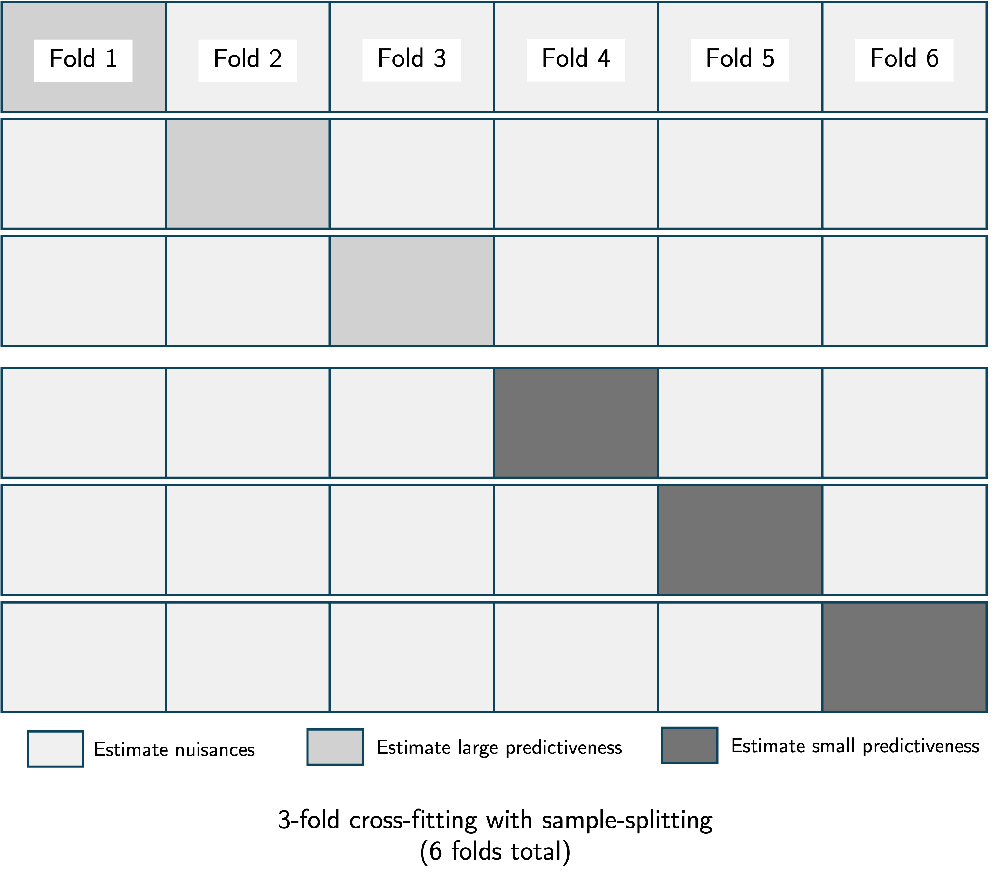

# Variable importance in survival analysis: multi-seed estimation

``` r
library(survML)
#> Loading required package: SuperLearner
#> Loading required package: nnls
#> Loading required package: gam
#> Loading required package: splines
#> Loading required package: foreach
#> Loaded gam 1.22-6
#> Super Learner
#> Version: 2.0-29
#> Package created on 2024-02-06
library(survival)
library(dplyr)
#> 
#> Attaching package: 'dplyr'
#> The following objects are masked from 'package:stats':
#> 
#>     filter, lag
#> The following objects are masked from 'package:base':
#> 
#>     intersect, setdiff, setequal, union
set.seed(72924)
```

## Introduction

As discussed in the variable importance [overview
vignette](https://cwolock.github.io/survML/articles/v2_variable_importance.html),
in order to obtain valid inference for VIM under the null hypothesis of
zero importance, we employ *sample-splitting*. We also use
*cross-fitting* in order to allow the use of flexible machine learning
algorithms for nuisance parameter estimation. (For a general overview of
variable importance, read the [overview
vignette](https://cwolock.github.io/survML/articles/v2_variable_importance.html)
first. We use the same notation here.)

We recall that the importance of a covariate set $X_{s\backslash r}$
relative to a larger covariate set $X_{s}$ is
$V\left( f_{0,r},P_{0} \right) - V\left( f_{0,s},P_{0} \right)$; the
difference in maximum achievable predictiveness when only $r$ is
excluded compared to when $s$ is excluded from the full covariate set
$X$. Sample-splitting entails estimating $V\left( f_{0,r},P_{0} \right)$
and $V\left( f_{0,s},P_{0} \right)$ using separate portions of the data.
This serves a distinct purpose from cross-fitting, which involves
dividing the data into $K$ folds, estimating the nuisance parameters
using $K - 1$ folds, estimating predictiveness using the remaining
holdout fold, repeating this process for all $K$ folds, and averaging
the results. We recommend using cross-fitting in conjunction with
sample-splitting, as illustrated in the figure below.



While cross-fitting does not change the large-sample variance of the VIM
estimator, sample-splitting does lead to an estimator with larger
variance. Furthermore, both sample-splitting and cross-fitting introduce
additional randomness into the inferential procedure due to the random
allocation of data units into folds.

## Muli-seed VIM estimation

Each iteration of the VIM procedure depends on the *seed* selected by
the user. The seed determines the pseudo-random process by which the
data are divided into folds, along with other stochastic components of
the VIM estimation procedure (e.g., cross-validation for selection of
algorithm tuning parameters).

In order to mitigate this randomness, we generally recommend performing
the VIM procedure multiple times using different seeds, and then
aggregating the results. This functionality is carried out by the
[`multiseed_vim()`](https://cwolock.github.io/survML/reference/multiseed_vim.md)
function. Suppose we use $J$ different seeds to perform the VIM
analyses. We denote the VIM point estimate produced by the $j$th seed as
$\psi_{n,j}$, and the corresponding estimated (scaled) variance as
$\sigma_{n,j}^{2}$. Aggregating the point estimates and inferential
results across the $J$ iterations require different approaches.

### Point estimates

We have point estimates $\{\psi_{n,1},\psi_{n,2},\ldots,\psi_{n,J}\}$.
Because all of these point estimates are consistent for the true VIM
$\psi_{0}$, many aggregation strategies will produce valid results. We
recommend simple averaging, constructing an overall VIM estimate
${\bar{\psi}}_{n}:=\frac{1}{J}\sum_{j = 1}^{J}\psi_{n,j}$.

### Inference

Combining the inferential results — confidence intervals and $p$-values
— across multiple seeds is more complicated. Each of the $J$ iterations
of the procedure produces a valid hypothesis test of the null hypothesis
$H_{c}:\psi_{0} = c$ for any value $c$ (most often, we are interested in
testing $H_{0}$ — that is, zero importance — but we can test any point
null). Thus, aggregating the $p$-values from the various seeds in a
manner that controls the Type I error of the aggregated hypothesis test
allows us to obtain a single $p$-value corresponding to a hypothesis
test of $H_{c}$.

There is a large literature on combining multiple $p$-values for testing
the same hypothesis; see Vovk and Wang (2020) for an in-depth analysis
of potential aggregation methods. Example aggregation methods include
Bonferroni (multiply the smallest $p$-value by the number of seeds) and
the arithmetic mean (take the arithmetic mean of the $p$-values and
multiply by two).

In `survML`, we use the Wald test statistic
$\left( \sigma_{n,j}^{2} \right)^{- 1/2}\left( \psi_{n,j} - c \right)$
to test $H_{c}$. We denote the resulting $p$-value as $p_{n,j,c}$. We
apply some aggregation function $g{()}$ to produce a combined $p$-value
$p_{n,c}^{*} = g\left( p_{n,c,1},p_{n,c,2},\ldots,p_{n,c,J} \right)$. A
$1 - \alpha$ confidence interval for $\psi_{0}$ consists of all values
$c$ for which $p_{n,c}^{*} > \alpha$, i.e., for which we do not reject
the null $H_{c}$. If the $p$-values correspond to a one-sided test, the
resulting interval is one-sided (i.e., it is of the form
$\left( L_{n},\infty \right)$ for a lower bound $L_{n}$); if the
$p$-values correspond to a two-sided test, the resulting interval is
two-sided. The
[`multiseed_vim()`](https://cwolock.github.io/survML/reference/multiseed_vim.md)
function produces both types of intervals, along with the aggregated
$p$-value corresponding to a one-sided test of $H_{0}$ (zero
importance).

## Example: Predicting recurrence-free survival time in cancer patients

As in the variable importance [overview
vignette](https://cwolock.github.io/survML/articles/v2_variable_importance.html),
we consider the importance of various features for predicting
recurrence-free survival time using the `gbsg` dataset from the
`survival` package. For illustration, we look at the importance of
tumor-level features (size, nodes, estrogen receptor, progesterone
receptor, and grade) relative to the full feature vector.

There are three arguments unique to
[`multiseed_vim()`](https://cwolock.github.io/survML/reference/multiseed_vim.md)
compared to the standard
[`vim()`](https://cwolock.github.io/survML/reference/vim.md) function.
The first is `n_seed`, which determines the number of iterations to
perform. The second is `ci_grid`, which determines the values of $c$ for
which hypothesis tests are performed. This argument should correspond to
a range of values over which a feasible confidence interval could span.
For example, for AUC predictiveness, the importance of a feature cannot
be outside of $(0,1)$, so these are reasonable bounds for `ci_grid`. The
third argument is `agg_method`, which determines the $p$-value
aggregation method. Vovk and Wang (2020) found the compound
Bonferroni-geometric mean method `"compound_bg"` to work well in
simulations; this is the default for
[`multiseed_vim()`](https://cwolock.github.io/survML/reference/multiseed_vim.md).
Below, we compare the results of a single call to
[`vim()`](https://cwolock.github.io/survML/reference/vim.md) versus the
multiseed approach with 3 seeds.

``` r
data(cancer)

### variables of interest
# rfstime - recurrence-free survival
# status - censoring indicator
# hormon - hormonal therapy treatment indicator
# age - in years
# meno - 1 = premenopause, 2 = post
# size - tumor size in mm
# grade - factor 1,2,3
# nodes - number of positive nodes
# pgr - progesterone receptor in fmol
# er - estrogen receptor in fmol

# create dummy variables and clean data
gbsg$tumgrad2 <- ifelse(gbsg$grade == 2, 1, 0)
gbsg$tumgrad3 <- ifelse(gbsg$grade == 3, 1, 0)
gbsg <- gbsg %>% na.omit() %>% select(-c(pid, grade))

time <- gbsg$rfstime
event <- gbsg$status
X <- gbsg %>% select(-c(rfstime, status)) # remove outcome 

# find column indices of features/feature groups
X_names <- names(X)
tum_index <- which(X_names %in% c("size", "nodes", "pgr", "er", "tumgrad2", "tumgrad3"))

landmark_times <- c(1000, 2000)

output_single <- vim(type = "AUC",
                     time = time,
                     event = event,
                     X = X,
                     landmark_times = landmark_times,
                     large_feature_vector = 1:ncol(X),
                     small_feature_vector = (1:ncol(X))[-as.numeric(tum_index)],
                     conditional_surv_generator_control = list(SL.library = c("SL.mean", "SL.glm"),
                                                               V = 2,
                                                               bin_size = 0.5),
                     large_oracle_generator_control = list(SL.library = c("SL.mean", "SL.glm"),
                                                           V = 2),
                     small_oracle_generator_control = list(SL.library = c("SL.mean", "SL.glm"),
                                                           V = 2),
                     approx_times = sort(unique(stats::quantile(time[event == 1 & time <= max(landmark_times)],
                                                                probs = seq(0, 1, by = 0.025)))),
                     cf_fold_num = 2,
                     sample_split = TRUE,
                     scale_est = TRUE)
#> Warning: glm.fit: fitted probabilities numerically 0 or 1 occurred
#> Warning: glm.fit: fitted probabilities numerically 0 or 1 occurred
#> Warning: glm.fit: fitted probabilities numerically 0 or 1 occurred
#> Warning: glm.fit: fitted probabilities numerically 0 or 1 occurred
#> Warning: glm.fit: fitted probabilities numerically 0 or 1 occurred

output_single$result
#>   landmark_time        est   var_est       cil       ciu cil_1sided
#> 1          1000 0.18408503 0.5787338 0.1035768 0.2645933  0.1165204
#> 2          2000 0.05050178 2.6346037 0.0000000 0.2222763  0.0000000
#>              p large_predictiveness small_predictiveness vim
#> 1 3.705528e-06            0.7049526            0.5208675 AUC
#> 2 2.822298e-01            0.6523270            0.6018252 AUC
#>   large_feature_vector small_feature_vector
#> 1    1,2,3,4,5,6,7,8,9                1,2,7
#> 2    1,2,3,4,5,6,7,8,9                1,2,7

output_multiseed <- multiseed_vim(n_seed = 3,
                                  ci_grid = seq(0, 1, by = 0.01),
                                  type = "AUC",
                                  agg_method = "compound_bg",
                                  time = time,
                                  event = event,
                                  X = X,
                                  landmark_times = landmark_times,
                                  large_feature_vector = 1:ncol(X),
                                  small_feature_vector = (1:ncol(X))[-as.numeric(tum_index)],
                                  conditional_surv_generator_control = list(SL.library = c("SL.mean", "SL.glm"),
                                                                            V = 2,
                                                                            bin_size = 0.5),
                                  large_oracle_generator_control = list(SL.library = c("SL.mean", "SL.glm"),
                                                                        V = 2),
                                  small_oracle_generator_control = list(SL.library = c("SL.mean", "SL.glm"),
                                                                        V = 2),
                                  approx_times = sort(unique(stats::quantile(time[event == 1 & time <= max(landmark_times)],
                                                                             probs = seq(0, 1, by = 0.025)))),
                                  cf_fold_num = 2,
                                  sample_split = TRUE,
                                  scale_est = TRUE)
#> Warning: glm.fit: fitted probabilities numerically 0 or 1 occurred
#> Warning: glm.fit: fitted probabilities numerically 0 or 1 occurred
#> Warning: glm.fit: fitted probabilities numerically 0 or 1 occurred
#> Warning: glm.fit: fitted probabilities numerically 0 or 1 occurred
#> Warning: glm.fit: fitted probabilities numerically 0 or 1 occurred
#> Warning: glm.fit: fitted probabilities numerically 0 or 1 occurred
#> Warning: glm.fit: fitted probabilities numerically 0 or 1 occurred
#> Warning: glm.fit: fitted probabilities numerically 0 or 1 occurred
#> Warning: glm.fit: fitted probabilities numerically 0 or 1 occurred
#> Warning: glm.fit: fitted probabilities numerically 0 or 1 occurred
#> Warning: glm.fit: fitted probabilities numerically 0 or 1 occurred
#> Warning: glm.fit: fitted probabilities numerically 0 or 1 occurred
#> Warning: glm.fit: fitted probabilities numerically 0 or 1 occurred
output_multiseed$agg_result
#>   landmark_time       est   var_est  cil  ciu cil_1sided            p
#> 1          1000 0.1718534 0.5610887 0.09 0.27       0.10 7.046226e-06
#> 2          2000 0.1746481 2.9069883 0.00 0.32       0.02 2.665718e-02
#>   large_predictiveness small_predictiveness vim large_feature_vector
#> 1            0.7079477            0.5360943 AUC    1,2,3,4,5,6,7,8,9
#> 2            0.7174815            0.5428334 AUC    1,2,3,4,5,6,7,8,9
#>   small_feature_vector
#> 1                1,2,7
#> 2                1,2,7
```

## References

The survival variable importance methodology is described in

Charles J. Wolock, Peter B. Gilbert, Noah Simon and Marco Carone.
[“Assessing variable importance in survival analysis using machine
learning.”](https://doi.org/10.1093/biomet/asae061) *Biometrika* (2025).

Methods for aggregating $p$-values are discussed in

Vladimir Vovk and Ruodu Wang. [“Combining p-values via
averaging.”](https://doi.org/10.1093/biomet/asaa027) *Biometrika*
(2020).
